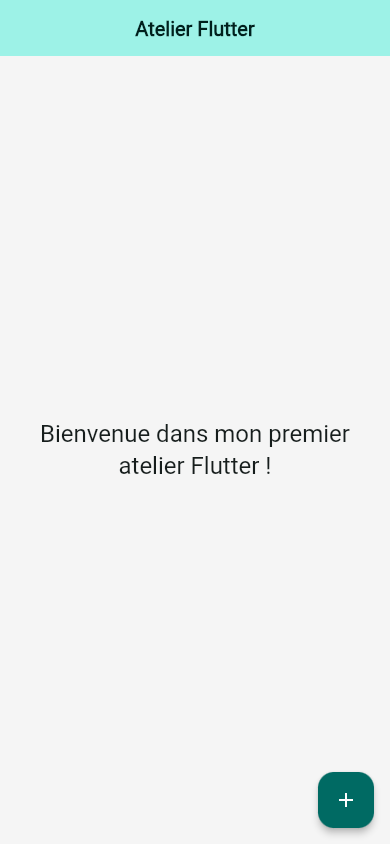
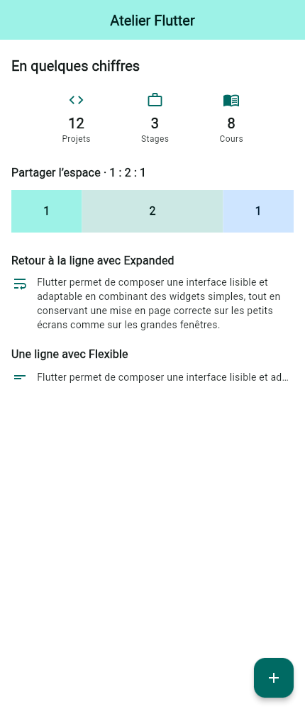
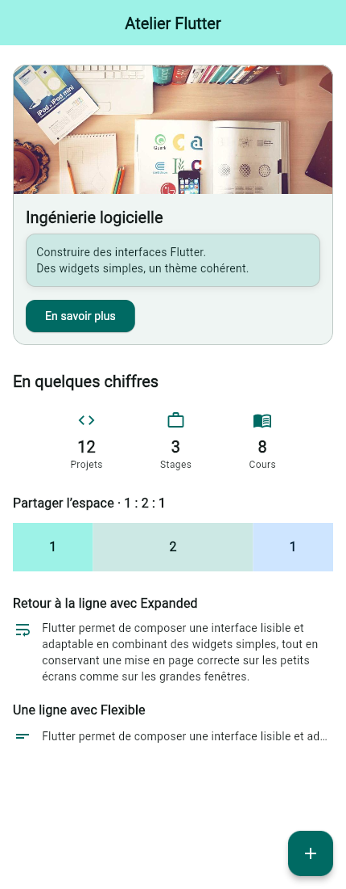
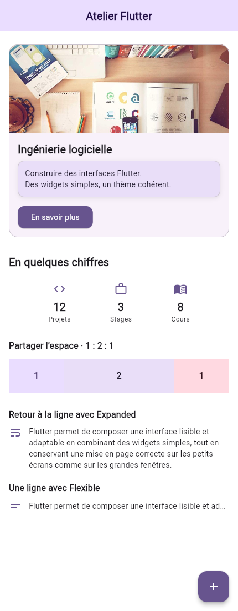
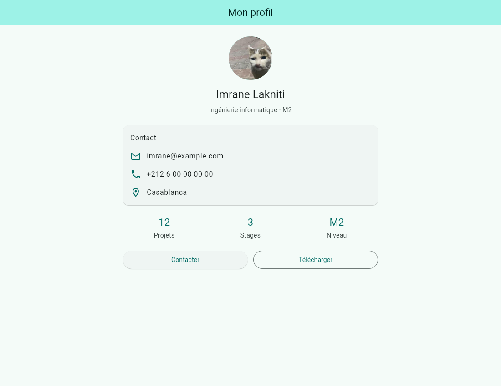
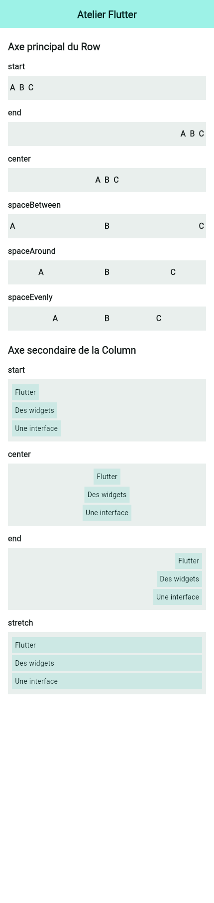

# Atelier Flutter 1 — interfaces, widgets et thèmes

Travail d’**Imrane Lakniti** : les exercices **A à D** et le mini-projet **fiche de profil étudiant**, réalisés dans deux projets Flutter distincts. Les interfaces utilisent Material 3 et des `StatelessWidget`, conformément au périmètre de l’atelier : un écran par application, sans navigation ni gestion d’état.

## Aperçu des exercices

Les captures montrent les applications Flutter Web exécutées dans **Google Chrome avec Chromium**, aux dimensions précisées dans le [rapport des captures](docs/screenshots/capture-report.json). Ce sont des rendus de l’application, sans cadre de téléphone ajouté.

| A — Structure Material | B — Carte de cours | C — Mise en page |
| :---: | :---: | :---: |
|  |  |  |

**A** isole la structure de l’écran. **B** ajoute une carte illustrée. **C** montre la répartition horizontale, les blocs proportionnels et le comportement d’un texte long.

### D — Une interface, trois configurations de thème

| Clair — graine turquoise | Sombre — même graine | Clair — graine violette |
| :---: | :---: | :---: |
|  |  |  |

La carte et les exercices de disposition sont les mêmes dans les trois vues. Seuls le mode et la couleur de départ changent : les rôles `primary`, `primaryContainer`, `secondaryContainer` et leurs couleurs de texte adaptent l’ensemble de l’interface.

### Mini-projet — Mon profil

| Thème clair | Thème sombre |
| :---: | :---: |
|  |  |

L’ordre demandé est conservé : avatar et identité, carte Contact, trois statistiques, puis deux boutons de même largeur. Sur une grande fenêtre, le contenu reste centré et sa largeur est limitée ; sur une petite fenêtre, le texte se replie et le contenu défile verticalement.

<details>
<summary>Afficher la capture sur une fenêtre de bureau</summary>



</details>

Le nom et l’avatar correspondent au compte GitHub d’Imrane Lakniti. **L’adresse e-mail, le téléphone, la ville, la filière, le niveau d’étude et les statistiques sont des données d’exemple**, pas des informations personnelles vérifiées. Les boutons affichent uniquement un message avec `debugPrint` : ils ne passent aucun appel et ne téléchargent aucun document.

## Lancer les applications

Environnement utilisé : **Flutter 3.35.7**, **Dart 3.9.2**, Google Chrome pour le Web. Depuis la racine du dépôt :

```powershell
cd atelier1
flutter pub get
flutter run -d chrome
```

Le point d’entrée par défaut est la composition finale **D**. Pour revoir les étapes séparément, lancer une seule commande à la fois depuis `atelier1` :

| Écran | Commande |
| --- | --- |
| A — structure initiale et fond gris clair | `flutter run -d chrome -t lib/main_a.dart --dart-define=APP_THEME=light` |
| B — carte de présentation du cours | `flutter run -d chrome -t lib/main_b.dart` |
| C — statistiques, proportions et corrections | `flutter run -d chrome -t lib/main_c.dart` |
| D — résultat thématisé complet | `flutter run -d chrome -t lib/main.dart` |
| Comparaison des alignements | `flutter run -d chrome -t lib/main_alignments.dart` |
| Reproduction volontaire du débordement, en debug | `flutter run -d chrome -t lib/main_overflow.dart` |

`main_overflow.dart` est une démonstration volontairement incorrecte et séparée. Elle produit le diagnostic de débordement étudié dans C. Les points d’entrée ordinaires présentent les deux corrections.

Pour le mini-projet, depuis la racine du dépôt :

```powershell
cd profil_etudiant
flutter pub get
flutter run -d chrome
```

### Choisir le mode et la couleur

Depuis le dossier `atelier1` :

```powershell
flutter run -d chrome --dart-define=APP_THEME=light
flutter run -d chrome --dart-define=APP_THEME=dark
flutter run -d chrome --dart-define=APP_THEME=light --dart-define=SEED_COLOR=0xFF7C3AED
```

`APP_THEME` accepte `light`, `dark` ou `system` ; la valeur par défaut est `system`. La graine de l’atelier est `0xFF0F766E`. Le mini-projet accepte aussi `APP_THEME`, avec une graine commune à ses thèmes clair et sombre définie dans son `main.dart`.

Dans une version Web lancée avec le `main.dart` de l’atelier, ajouter ces paramètres à l’adresse et recharger la page :

```text
/?exercise=a&theme=light
/?exercise=b&theme=light
/?exercise=c&theme=light
/?exercise=d&theme=dark
/?exercise=d&theme=light&seed=0xFF7C3AED
/?exercise=alignments&theme=light
```

Les paramètres d’URL prennent priorité sur les valeurs de compilation. Le profil accepte `/?theme=light` et `/?theme=dark`. Chaque choix configure l’application au démarrage ; aucun mécanisme de navigation ou de changement d’état n’est ajouté.

## Organisation du code

```text
atelier1/
  lib/main.dart                 # Composition D et choix par URL
  lib/main_a.dart, main_b.dart, main_c.dart
  lib/main_alignments.dart      # Comparaisons visuelles
  lib/main_overflow.dart        # Erreur volontaire, isolée
  lib/src/app.dart              # MaterialApp et sélection de l’exercice
  lib/src/theme.dart            # Thèmes et rôles de couleurs
  lib/src/pages.dart            # Scaffold, écrans et contenu défilant
  lib/src/widgets.dart          # Carte, statistiques et exemples de Row
  assets/images/course.jpg      # Image locale de secours
  test/widget_test.dart
profil_etudiant/
  lib/main.dart                 # MyApp, ProfilPage, InfoRow et Stat
  assets/images/avatar.jpg      # Avatar embarqué
  test/widget_test.dart
tools/capture_screenshots.cjs    # Captures reproductibles
docs/screenshots/               # Images et rapport du navigateur
docs/verification/              # Résultats des vérifications et diagnostic
```

Les deux projets comprennent des dossiers `web` et `android`. Les captures et vérifications d’exécution présentées ici concernent le Web ; aucun lancement sur un appareil ou émulateur Android n’est revendiqué.

## Explication des exercices

### A — `MaterialApp` et `Scaffold`

`runApp` installe le widget racine `MyApp`. `MaterialApp` configure le titre et les thèmes, puis reçoit `HomePage` comme écran d’accueil. `HomePage` construit le `Scaffold` : une `AppBar` centrée, un `body` et un `FloatingActionButton` qui écrit `FAB cliqué` dans la console.

L’entrée A conserve l’étape initiale avec le fond `Colors.grey.shade100` dans son thème clair et le texte de bienvenue modifié. La commande A ci-dessus force ce mode pour montrer cette étape. La composition finale D utilise les couleurs du thème pour tout son contenu.

Pour observer le hot reload, modifier le texte dans [pages.dart](atelier1/lib/src/pages.dart), enregistrer, puis utiliser `r` dans la session `flutter run` si nécessaire. Le Widget Inspector de Flutter DevTools permet d’examiner l’arbre `MaterialApp → HomePage → Scaffold`. Ces indications décrivent la manipulation à reproduire ; aucune session manuelle de DevTools n’a été enregistrée.

### B — Une carte de présentation

[CourseCard](atelier1/lib/src/widgets.dart) respecte les dimensions de l’énoncé : rayon **16**, marge extérieure **16**, image réseau de hauteur **160** sur toute la largeur avec `BoxFit.cover`, et marge intérieure **16**. `clipBehavior: Clip.antiAlias` suit les coins arrondis de la carte.

Le titre utilise `textTheme.titleLarge`, configuré globalement en **20 px et gras**. Un espace de **8 px** le sépare de la description limitée à deux lignes. Le `Container` de description regroupe fond coloré, bordure, coins arrondis et ombre dans `BoxDecoration`. Le bouton « En savoir plus » affiche son message avec `debugPrint`.

L’image est chargée avec `Image.network`. En cas d’échec réseau, `errorBuilder` affiche la copie locale déclarée dans `pubspec.yaml`, ce qui conserve la carte utilisable hors connexion.

### C — Axes, alignements et proportions

Une `Row` dispose ses enfants horizontalement ; une `Column` les empile verticalement. La barre de statistiques associe une icône, une valeur en gras et un libellé dans trois colonnes, réparties avec `MainAxisAlignment.spaceEvenly`.

Sous la barre, trois `Expanded` de `flex` **1, 2 et 1** partagent la largeur disponible : un quart, la moitié, puis un quart. Chaque bloc a une hauteur de **60 px**.

Observations sur l’axe principal d’une `Row`, en lecture de gauche à droite :

| Alignement | Rendu obtenu |
| --- | --- |
| `spaceEvenly` | Tous les espaces sont identiques, y compris aux deux extrémités. |
| `spaceBetween` | L’espace libre est réparti entre les enfants ; aucun espace n’est ajouté aux extrémités. |
| `spaceAround` | Chaque enfant possède le même espace autour de lui ; un espace intérieur vaut deux fois un espace extérieur. |
| `start` | Les enfants sont regroupés à gauche. |
| `center` | Les enfants sont regroupés au centre. |
| `end` | Les enfants sont regroupés à droite. |

Observations sur l’axe secondaire d’une `Column` :

| Alignement | Rendu obtenu |
| --- | --- |
| `start` | Les enfants sont alignés à gauche. |
| `center` | Les enfants sont centrés horizontalement. |
| `end` | Les enfants sont alignés à droite. |
| `stretch` | Les enfants prennent toute la largeur disponible ; cela ne centre pas automatiquement leur texte. |

Le comparateur donne aux `Row` une largeur supérieure à celle de leurs enfants, et aux `Column` des enfants de largeurs différentes : les changements restent visibles.

<details>
<summary>Afficher les six alignements principaux et les quatre alignements secondaires</summary>



</details>

#### Débordement : diagnostic et deux corrections

Une phrase de plus de 100 caractères, placée directement dans une `Row`, peut demander plus de largeur que l’écran. La cible pédagogique `main_overflow.dart` reproduit ce cas. Le [diagnostic réel capturé](docs/verification/overflow.txt) contient `A RenderFlex overflowed by … pixels on the right` ; la valeur dépend de la fenêtre et de la police, elle n’est pas une constante du programme.

**Correction 1 — conserver tout le texte :** `Expanded` attribue au texte la largeur restante et permet son retour à la ligne.

```dart
Row(
  children: [
    const Icon(Icons.wrap_text),
    const SizedBox(width: 12),
    Expanded(child: Text(longDescription)),
  ],
)
```

**Correction 2 — conserver une seule ligne :** `Flexible` borne la largeur du texte, puis `maxLines` et `ellipsis` raccourcissent l’affichage.

```dart
Row(
  children: [
    const Icon(Icons.short_text),
    const SizedBox(width: 12),
    Flexible(
      child: Text(
        longDescription,
        maxLines: 1,
        overflow: TextOverflow.ellipsis,
      ),
    ),
  ],
)
```

Ajouter seulement `ellipsis` sans contraindre la largeur d’un enfant de `Row` ne suffit pas. Les deux solutions sont visibles dans la composition C et dans la version finale D.

### D — Centraliser l’apparence

[theme.dart](atelier1/lib/src/theme.dart) génère les deux palettes avec `ColorScheme.fromSeed`, à partir de la même graine et de deux valeurs de `Brightness`. Les fonds et textes utilisent des paires de rôles comme `secondaryContainer` / `onSecondaryContainer`, plutôt que des couleurs indépendantes. Les styles de texte viennent de `textTheme` et sont adaptés avec `copyWith`.

La barre de titre, les boutons et le bouton flottant lisent leur apparence dans le thème global. Remplacer la graine turquoise par la graine violette modifie donc ces composants sans modifier leur code. Le passage au mode sombre conserve des couleurs de texte adaptées aux surfaces.

## Mini-projet : composants réutilisables

[ProfilPage](profil_etudiant/lib/main.dart) assemble un `CircleAvatar`, le nom en `headlineSmall`, puis la filière et l’année en `bodyMedium` avec `onSurfaceVariant`. La carte Contact utilise trois `InfoRow`, chacune composée d’une icône et d’un texte dans une `Row`.

`InfoRow` place le texte dans `Expanded` pour permettre son repli. `Stat(value, label)` factorise les trois indicateurs. Les deux boutons occupent chacun un `Expanded` de même poids ; leur rangée adapte sa hauteur lorsque les libellés passent sur plusieurs lignes. `SingleChildScrollView` conserve l’accès au contenu dans les petites fenêtres et `ConstrainedBox` évite son étirement sur les grands écrans. Toutes les couleurs de l’interface proviennent du thème.

## Réponses aux questions de compréhension

1. **Différence entre `MaterialApp` et `Scaffold` ?** `MaterialApp` configure l’application Material, notamment ses thèmes et son écran d’accueil. `Scaffold` fournit la structure d’un écran : barre de titre, corps et bouton flottant.
2. **Différence entre `margin` et `padding` ?** `margin` crée de l’espace à l’extérieur du `Container`. `padding` sépare sa décoration de son contenu, à l’intérieur.
3. **Sur quel axe agit `mainAxisAlignment` ?** Sur l’axe vertical dans une `Column` et sur l’axe horizontal dans une `Row`.
4. **Pourquoi utiliser `Theme.of(context).colorScheme.primary` ?** Ce rôle suit le thème actif, centralise les choix visuels et s’adapte aux modes clair et sombre ; une couleur fixe comme `Colors.blue` ne suit pas ces changements.
5. **Quelle largeur pour deux `Expanded` de `flex` 2 et 1 ?** Ils reçoivent respectivement deux tiers et un tiers de l’espace partagé, après retrait de la largeur des autres enfants et des espacements.
6. **Pourquoi ne pas associer `color` et `decoration` dans un `Container` ?** Son constructeur interdit cette combinaison. Lorsqu’une décoration est utilisée, sa couleur de fond doit être placée dans `BoxDecoration(color: ...)`.

## Vérifications et reproduction des captures

Les deux projets passent `flutter analyze` sans problème et les **23 tests de widgets** réussissent : **14** pour les exercices et **9** pour le profil.

Les [résultats détaillés](docs/verification/results.json) donnent le statut exact des commandes exécutées. Les tests de widgets couvrent notamment les thèmes clair et sombre, les fenêtres étroites, le texte agrandi **×2**, les proportions **1:2:1**, les messages des boutons et le diagnostic volontaire isolé. Le profil comprend des cas **240 × 640**, **390 × 844** et **844 × 390** ; les exercices sont également vérifiés à **240 × 640** avec le texte agrandi.

Sous PowerShell, `./tools/verify.ps1` exécute les contrôles des deux projets et actualise automatiquement le rapport et le diagnostic de débordement.

Pour exécuter les contrôles et préparer les versions Web, depuis la racine :

```powershell
cd atelier1
flutter pub get
flutter analyze
flutter test
flutter build web --no-web-resources-cdn

cd ..\profil_etudiant
flutter pub get
flutter analyze
flutter test
flutter build web --no-web-resources-cdn

cd ..
npm install
npm run screenshots
```

Le script de captures utilise Google Chrome installé sur la machine. Il lance temporairement les deux versions Web sur les ports locaux **8765** et **8766**, produit les dix images ci-dessus et écrit leur [rapport de contrôle](docs/screenshots/capture-report.json), puis ferme le navigateur et les serveurs. Les captures utilisent le rendu Web ; elles ne constituent pas une validation Android.

## Sources des images

- Avatar GitHub d’Imrane : [image d’origine](https://avatars.githubusercontent.com/imranelak1?s=512), embarquée dans `profil_etudiant/assets/images/avatar.jpg`.
- Photo du cours : [Lorem Picsum, image 20](https://picsum.photos/id/20/1000/500), utilisée par `Image.network` et conservée dans `atelier1/assets/images/course.jpg` comme secours local.

Le PDF fourni sert de consigne à l’atelier et n’est pas redistribué dans ce dépôt.
