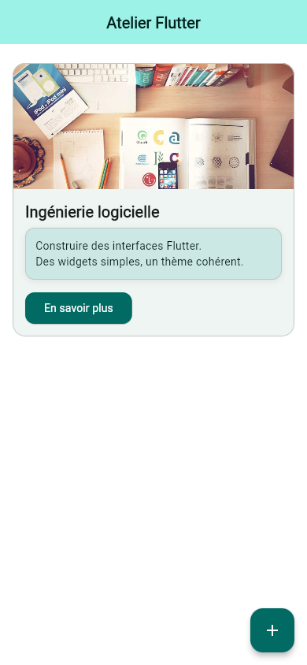
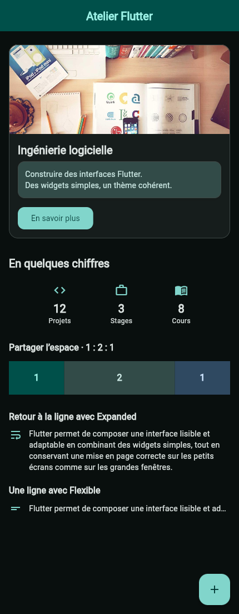

# Atelier 1 — exercices A à D

Application Flutter Material 3 consacrée à `Scaffold`, aux widgets de base, à `Row` / `Column` et aux thèmes. Tous les widgets écrits pour l’atelier sont des `StatelessWidget`.

Les [explications complètes, captures et réponses](../README.md) se trouvent à la racine du dépôt.

| Carte de cours | Composition finale sombre |
| :---: | :---: |
|  |  |

## Démarrer

Depuis ce dossier, avec Flutter **3.35.7**, Dart **3.9.2** et Google Chrome :

```powershell
flutter pub get
flutter run -d chrome
```

Le lancement ordinaire affiche **D**, qui rassemble la carte de B et les dispositions de C dans une interface entièrement thématisée.

| Étape | Commande |
| --- | --- |
| A — titre, texte centré, fond gris et FAB | `flutter run -d chrome -t lib/main_a.dart --dart-define=APP_THEME=light` |
| B — carte illustrée | `flutter run -d chrome -t lib/main_b.dart` |
| C — statistiques, flex 1:2:1 et texte long corrigé | `flutter run -d chrome -t lib/main_c.dart` |
| Comparaison des alignements | `flutter run -d chrome -t lib/main_alignments.dart` |
| Erreur volontaire de débordement, cible debug séparée | `flutter run -d chrome -t lib/main_overflow.dart` |

Pour comparer les thèmes :

```powershell
flutter run -d chrome --dart-define=APP_THEME=dark
flutter run -d chrome --dart-define=APP_THEME=light --dart-define=SEED_COLOR=0xFF7C3AED
```

Avec le `main.dart` ordinaire sur le Web, les paramètres `?exercise=a`, `b`, `c`, `d` ou `alignments`, `theme=light|dark|system` et `seed=0xFF7C3AED` permettent aussi de choisir la configuration au démarrage. Exemple : `/?exercise=d&theme=dark`. Recharger après modification de l’URL.

## Lire le code

- [app.dart](lib/src/app.dart) : `MaterialApp`, choix de l’exercice et thèmes.
- [theme.dart](lib/src/theme.dart) : génération des palettes et styles partagés.
- [pages.dart](lib/src/pages.dart) : `HomePage`, `Scaffold`, composition et comparateur d’alignements.
- [widgets.dart](lib/src/widgets.dart) : `CourseCard`, statistiques, proportions et deux corrections du débordement.

L’étape A conserve le fond gris clair d’origine dans le thème clair. D utilise les rôles `colorScheme` et les styles `textTheme`. L’image réseau de la carte dispose d’un secours local. Les boutons écrivent uniquement des messages avec `debugPrint`.

## Contrôler

```powershell
flutter analyze
flutter test
flutter build web --no-web-resources-cdn
```

Les [résultats](../docs/verification/results.json) et le [diagnostic de débordement volontaire](../docs/verification/overflow.txt) sont conservés à la racine. Le [README principal](../README.md#vérifications-et-reproduction-des-captures) explique la reproduction des captures Chromium. Le code Android est fourni ; les captures sont issues de Flutter Web.
