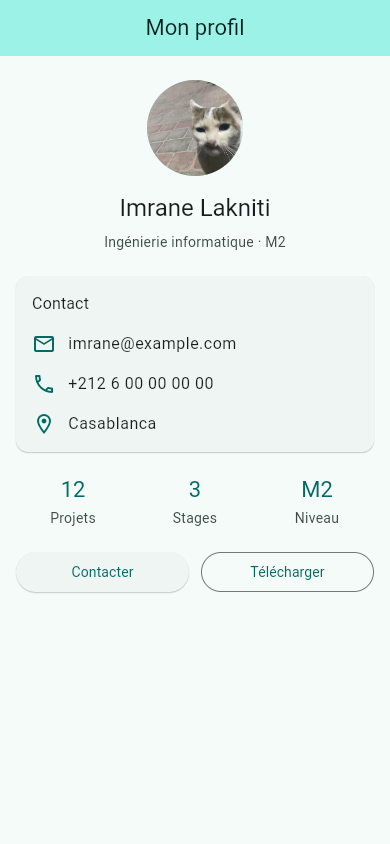
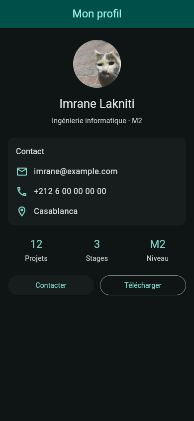

# Mini-projet — fiche de profil étudiant

Écran unique Flutter Material 3 avec avatar rond, identité, carte Contact, trois statistiques et deux boutons de même largeur. Les thèmes clair et sombre sont générés à partir de la même couleur de départ. Tous les widgets écrits pour ce projet sont des `StatelessWidget`.

| Clair | Sombre |
| :---: | :---: |
|  |  |

Les [explications de l’ensemble de l’atelier](../README.md), la [capture de bureau](../docs/screenshots/profil-desktop.png) et les [résultats des vérifications](../docs/verification/results.json) sont disponibles à la racine.

## Démarrer

Depuis ce dossier, avec Flutter **3.35.7**, Dart **3.9.2** et Google Chrome :

```powershell
flutter pub get
flutter run -d chrome
```

Forcer un mode au lancement :

```powershell
flutter run -d chrome --dart-define=APP_THEME=light
flutter run -d chrome --dart-define=APP_THEME=dark
```

Le mode par défaut est `system`. Dans le navigateur, `/?theme=light` ou `/?theme=dark` prend priorité ; recharger la page après modification de l’URL.

## Composition

[lib/main.dart](lib/main.dart) contient quatre widgets :

| Widget | Responsabilité |
| --- | --- |
| `MyApp` | Configure `MaterialApp` et les deux thèmes issus de la même graine. |
| `ProfilPage` | Assemble le `Scaffold`, l’AppBar centrée et le profil défilant. |
| `InfoRow` | Réutilise une ligne icône + texte, avec `Expanded` pour permettre le repli. |
| `Stat` | Affiche une valeur et son libellé à partir des styles du thème. |

Le nom utilise `headlineSmall`, la filière et l’année `bodyMedium` avec `onSurfaceVariant`. La carte Contact contient trois lignes. Les statistiques et les boutons partagent chacun leur rangée grâce à `Expanded`. Le contenu a une largeur maximale et peut défiler lorsque la fenêtre est petite. Toutes les couleurs de l’interface viennent du thème.

Le nom et l’avatar proviennent du compte GitHub d’Imrane Lakniti. **L’e-mail, le téléphone, la ville, la filière, l’année et les statistiques sont des données d’exemple**. Les boutons « Contacter » et « Télécharger » affichent seulement `debugPrint` : aucune prise de contact ni aucun téléchargement n’est effectué.

L’[avatar d’origine](https://avatars.githubusercontent.com/imranelak1?s=512) est embarqué dans `assets/images/avatar.jpg` et déclaré dans `pubspec.yaml`.

## Contrôler

```powershell
flutter analyze
flutter test
flutter build web --no-web-resources-cdn
```

Les tests vérifient le contenu, les messages des boutons, leurs largeurs égales et les thèmes clair/sombre. Les cas de mise en page incluent les fenêtres **240 × 640**, **390 × 844** et **844 × 390** avec le texte agrandi **×2**, ainsi qu’une adresse e-mail longue.

Les captures utilisent Flutter Web dans Chrome avec Chromium. Les sources Android sont incluses, mais aucun lancement sur appareil ou émulateur Android n’est revendiqué. Pour régénérer les captures, suivre la [procédure du dépôt](../README.md#vérifications-et-reproduction-des-captures).
